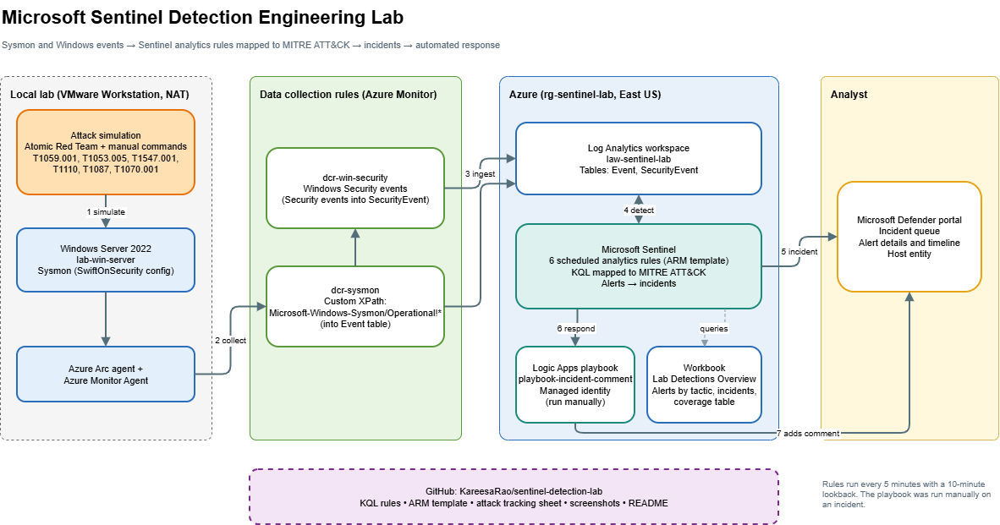
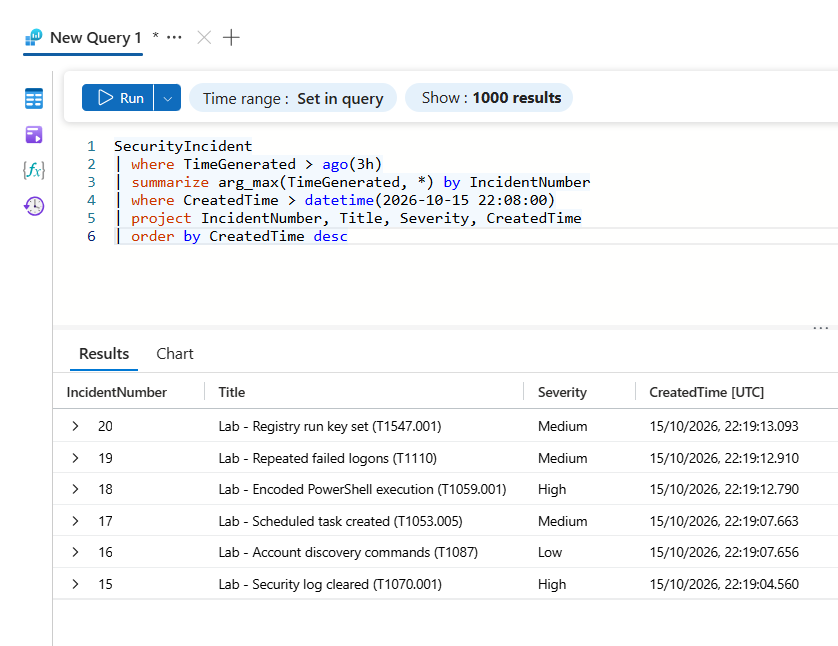

# Microsoft Sentinel Detection Engineering Lab

A personal lab where I built six custom Microsoft Sentinel analytics rules mapped to MITRE ATT&CK, simulated the matching attacks on a local Windows Server VM, and checked that each one raised a Sentinel incident.

> **Personal project.** Everything here runs on my own Azure free subscription and a local VM. No employer data, systems or accounts are involved.

## Results

| Technique | Tactic | Rule | Severity | Verification incident | Result |
|---|---|---|---|---|---|
| T1059.001 Encoded PowerShell | Execution | Lab - Encoded PowerShell execution (tuned) | High | #18 | Detected |
| T1053.005 Scheduled task | Persistence | Lab - Scheduled task created (tuned) | Medium | #17 | Detected |
| T1547.001 Registry run key | Persistence | Lab - Registry run key set | Medium | #20 | Detected |
| T1110 Brute force logons | Credential Access | Lab - Repeated failed logons | Medium | #19 | Detected |
| T1087 Account discovery | Discovery | Lab - Account discovery commands | Low | #16 | Detected |
| T1070.001 Clear event logs | Defense Evasion | Lab - Security log cleared | High | #15 | Detected |

- **6 of 6 simulated techniques raised a Sentinel incident.** This is a small lab test on one host, not a production measurement.
- **Log ingestion delay:** average 0.8 minutes, maximum 1.9 minutes (measured on my first three test runs).
- **Time to alert:** about 12 minutes in one example (first activity 2:44 PM ET, alert 2:55 PM ET). That includes the rule schedule, ingestion and portal sync. I have not broken down how much each part contributed.
- **Tuning (two rules only):** in my lab test, 8 of 8 benign admin events stopped being flagged while both simulated attacks were still caught. See [Tuning](#tuning-and-its-limits) for the caveats.

## Architecture

1. Attack simulations run on a Windows Server 2022 VM (Atomic Red Team plus manual commands).
2. Azure Arc and the Azure Monitor Agent collect events through two data collection rules.
3. Events land in a Log Analytics workspace (`SecurityEvent` and `Event` tables).
4. Six scheduled analytics rules in Microsoft Sentinel run KQL against those tables.
5. Matches become alerts and incidents, viewed in the Microsoft Defender portal.
6. A Logic Apps playbook can add a comment to an incident. I ran it manually.

## Setup

| Component | Detail |
|---|---|
| Cloud | Azure free subscription, resource group `rg-sentinel-lab` (East US), $10/month budget alert |
| Workspace | Log Analytics `law-sentinel-lab`, 5 GB daily cap, Microsoft Sentinel enabled |
| Lab VM | Windows Server 2022 Evaluation in VMware Workstation (4 GB RAM, NAT) |
| Endpoint telemetry | Sysmon (SwiftOnSecurity config), command-line process auditing |
| Attack tooling | Atomic Red Team plus manual commands |
| Collection | Azure Arc and Azure Monitor Agent |
| Data collection rules | `dcr-win-security` (Security events into `SecurityEvent`), `dcr-sysmon` (custom XPath `Microsoft-Windows-Sysmon/Operational!*` into `Event`) |
| Benign baseline | Harmless admin scripts in `C:\AdminScripts`, used to test tuning |

## Detections

All six rules are deployed from one ARM template: [`kql-rules/sentinel-lab-analytics-rules.json`](kql-rules/sentinel-lab-analytics-rules.json). Each rule runs every 5 minutes with a 10-minute lookback, maps the Host entity from `Computer`, and has incident grouping on.

| Rule | Technique | Data source | Logic |
|---|---|---|---|
| Encoded PowerShell execution | T1059.001 | Sysmon Event ID 1 | PowerShell started with an encoded command (tuned) |
| Scheduled task created | T1053.005 | Sysmon Event ID 1 | `schtasks.exe` creating a task (tuned) |
| Registry run key set | T1547.001 | Sysmon Event ID 13 | Value written under a Run key |
| Repeated failed logons | T1110 | Security Event 4625 | 5 or more failed logons |
| Account discovery commands | T1087 | Sysmon Event ID 1 | `net user`, `net localgroup`, `whoami /all` |
| Security log cleared | T1070.001 | Security Event 1102 | Audit log cleared |

The queries are in [`kql-rules/`](kql-rules/).

## Attack simulations

The commands I ran for each technique are in [`attack-simulations/`](attack-simulations/), with the results in [`attack-tracking.csv`](attack-simulations/attack-tracking.csv). All of them were run against my own lab VM.

## Example investigation: encoded PowerShell

| Field | Detail |
|---|---|
| Incident | Lab - Encoded PowerShell execution (T1059.001) |
| Severity | High |
| Tactic / technique | Execution / T1059.001 (PowerShell) |
| Detection | Scheduled analytics rule in Microsoft Sentinel |
| Data source | Sysmon Event ID 1 (process creation) |
| First activity | Oct 15, 2026, 2:44 PM ET (18:44 UTC) |
| Alert generated | Oct 15, 2026, 2:55 PM ET (about 12 minutes later) |

**What happened:** I ran PowerShell with an encoded command on the lab server to simulate T1059.001. Sysmon logged the process creation, the Sentinel rule matched the encoded-command flag in the command line, and an alert and incident were created.

**Why it matters:** Attackers encode PowerShell commands to hide them from simple string matching and quick log review.

**Verdict:** Expected. This was my own attack simulation.

**What I would do in production:** decode the command, check the parent process and the user, look for related alerts on the same host, and isolate the host if the activity is not authorized.

### Checking the raw logs

After deploying all six rules, I ran a harmless admin batch first, then the attacks. I confirmed in `SecurityEvent` that the two tuned rules fired on the attack commands and not on the admin activity:

- 22:09:57 UTC: benign `NightlyBackup` task created and deleted. No incident.
- 22:10:27 UTC: `powershell.exe -NoProfile -EncodedCommand ...`. Incident #18.
- 22:10:28 UTC: `schtasks /create /tn LabEvil2 ...`. Incident #17.

## Workbook

An Azure Monitor workbook, **Lab Detections Overview**, shows incidents by severity, alerts by MITRE tactic and a detection coverage table. Counts include duplicate alerts from all my test runs.

## Response playbook

A Logic Apps playbook (`playbook-incident-comment`) triggers on a Microsoft Sentinel incident and adds a comment to it. It uses a system-assigned managed identity with the Microsoft Sentinel Responder role, so no credentials are stored. **I ran it manually on one incident and confirmed the comment appeared, authored by the playbook. It is not attached to an automation rule.** Details in [`playbooks/`](playbooks/).

## Tuning and its limits

Admin scripts and management tools also use encoded PowerShell and scheduled tasks, so I tuned two rules to exclude activity that comes from `C:\AdminScripts`.

| Rule | Benign events flagged before | After |
|---|---|---|
| Encoded PowerShell execution | 5 | 0 |
| Scheduled task created | 3 | 0 |

In my lab test, 8 of 8 benign admin events stopped being flagged while both simulated attacks were still caught.

Caveats:
- This is a very small test on one VM, not a false-positive rate.
- The other four rules were not tuned. The run key rule was not tested against benign activity.
- The exclusion is an allowlist. An attacker who can write to `C:\AdminScripts` could hide there. A production version would need tighter controls, such as signed scripts or file integrity monitoring.

**Duplicate incidents:** the 10-minute lookback overlaps the 5-minute schedule, so the same event can be matched twice. Earlier test runs produced duplicates (for example, two Registry run key incidents). The six-rule deployment has incident grouping turned on. I did not measure how much it reduced duplicates.

## Limitations and next steps

- One host, one environment, small number of runs.
- T1003 (credential dumping) and T1562.001 (disabling security tools) are planned but not run.
- Security Event 4698 was not checked for the scheduled task rule.
- The playbook is not triggered automatically.

## What I learned

- A rule that fires is not the same as a rule that is right. I checked the raw command lines behind the incidents, not just the incident titles.
- Tuning is a trade-off: an allowlist removes noise but creates a place for an attacker to hide.
- The schedule and lookback settings shape both duplicates and time to alert.
- Atomic Red Team tests do not always run cleanly. One failed on a missing helper function, so I ran an equivalent command by hand and recorded that.

## Cost and cleanup

The lab runs on the Azure free trial with a 5 GB daily ingestion cap and a budget alert. I plan to delete the resource group before the trial ends. The rules, queries and diagrams stay in this repo.
----------------------------------------------------------------------------------------------------------------------------
# sentinel-detection-lab
Detection engineering lab with Microsoft Sentinel and MITRE ATT&amp;CK

### Example investigation: encoded PowerShell execution

| Field | Detail |
|---|---|
| Incident | Lab - Encoded PowerShell execution (T1059.001) |
| Severity | High |
| Tactic / technique | Execution / T1059.001 (PowerShell) |
| Detection | Scheduled analytics rule in Microsoft Sentinel |
| Data source | Sysmon Event ID 1 (process creation) |
| Host | WIN-NQUS8CJOBGD |
| First activity | Oct 15, 2026, 2:44 PM ET (18:44 UTC) |
| Alert generated | Oct 15, 2026, 2:55 PM ET (about 12 minutes later) |
| Status | [update after classifying] |

**What happened:** I ran PowerShell with an encoded command on the lab
server to simulate T1059.001. Sysmon logged the process creation, the
Sentinel rule matched the encoded-command flag in the command line, and an
alert and incident were created.

**Why it matters:** Attackers encode PowerShell commands to hide them from
simple string matching and quick log review.

**Verdict:** Expected. This was my own attack simulation.

**What I would do in production:** decode the command, check the parent
process and the user, look for related alerts on the same host, and isolate
the host if the activity is not authorized.

### Automated response

A Logic Apps playbook (`playbook-incident-comment`) runs on Sentinel
incidents and adds a triage comment with the incident title and severity.
It uses a system-assigned managed identity with the Microsoft Sentinel
Responder role, so no credentials are stored. I ran it manually on an
incident and confirmed the comment appears in the incident's activity log.
**Tuning note:** Admin scripts and management tools also use encoded
commands, so a real deployment needs exclusions for known parent processes
and paths.

**Time to alert:** About 12 minutes in this lab. The rule runs every 5
minutes with a 10-minute lookback, and I have not yet broken down how much
of the gap came from ingestion, the schedule, or portal sync.
